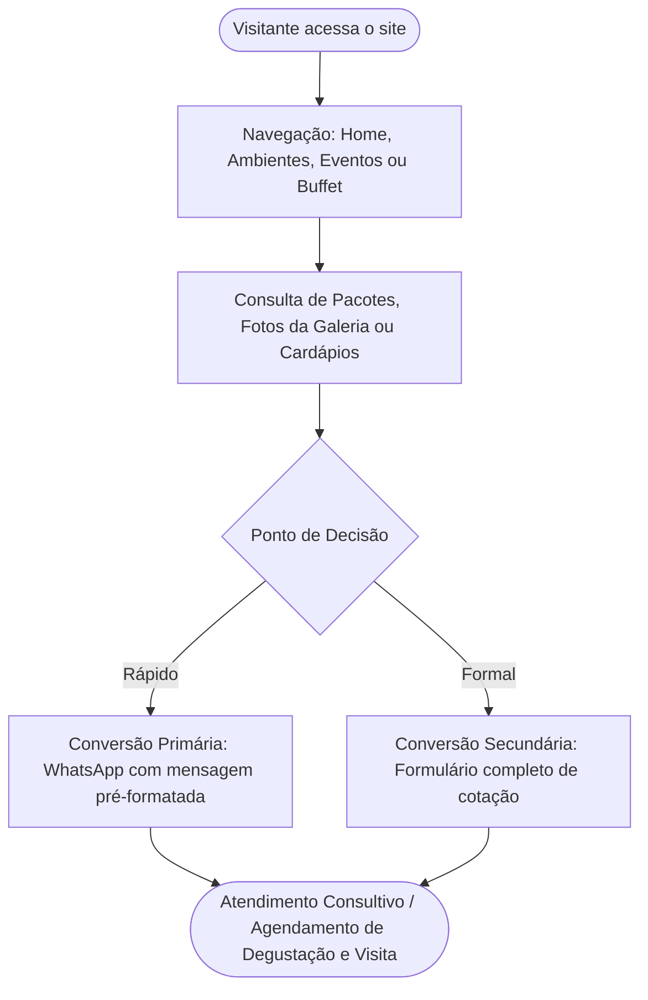

# Mapa do Site — Villa Aurora

> **Nota de Contexto Acadêmico:** Este documento reflete a arquitetura da informação, hierarquia de navegação e taxonomia de seções do site **Villa Aurora**, desenvolvido como projeto acadêmico de alta fidelidade. Todas as páginas, rotas e seções abaixo estão ativas no ambiente de produção.

---

## 1. Visão Geral da Arquitetura da Informação

O site adota uma navegação horizontal clássica, intuitiva e focada em conversão, estruturada em **7 rotas públicas principais**:

```
Villa Aurora (Raiz)
├── / (Início / Home)
├── /ambientes (Ambientes & Infraestrutura)
├── /eventos (Modalidades de Eventos)
├── /galeria (Galeria de Fotos & Portfólio)
├── /pacotes (Planos de Contratação)
├── /buffet (Gastronomia Autoral & Degustação)
└── /contato (Atendimento, Formulário, Localização & FAQ)
```

---

## 2. Detalhamento das Páginas e Estrutura de Seções

### 2.1. Página Inicial (`/` — `src/pages/index.astro`)
* **Objetivo:** Estabelecer a proposta de valor, despertar o desejo visual e direcionar o visitante para orçamentos ou exploração dos detalhes do espaço.
* **Estrutura de Seções:**
  1. **Hero Section:** Background imersivo em vídeo (`/hero-villa-aurora.mp4`), badge institucional, título de boas-vindas, subtítulo e CTA duplo ("Pedir Orçamento via WhatsApp" e "Conhecer Espaço").
  2. **Sobre a Villa Aurora (`#sobre`):** Texto institucional ressaltando arquitetura, exclusividade e história do espaço.
  3. **Mosaico de Ambientes (`#ambientes`):** Cards visuais com fotos do Salão Nobre, Jardim Cerimonial, Lounge Bar e Pista de Dança com links de aprofundamento.
  4. **Destaque da Gastronomia (`#buffet`):** Apresentação do conceito de buffet próprio integrado, cardápios autorais e CTA para agendar degustação.
  5. **Modalidades de Eventos (`#eventos`):** Grid com cards de Casamentos, 15 Anos, Aniversários, Formaturas e Eventos Corporativos.
  6. **Diferenciais Estruturais (`#diferenciais`):** Grid com ícones destacando localização nobre, gerador de alta potência, acessibilidade total, climatização central digital e camarim privativo.
  7. **Depoimentos de Clientes (`#depoimentos`):** Depoimentos reais/fictícios de anfitriões com citações e formatos de evento.
  8. **Banner CTA Final:** Faixa conclusiva convidando para conversa direta com a equipe de curadoria do espaço.

---

### 2.2. Ambientes (`/ambientes` — `src/pages/ambientes.astro`)
* **Objetivo:** Apresentar a infraestrutura física detalhada, dimensões, recursos tecnológicos e versatilidade dos espaços.
* **Estrutura de Seções:**
  1. **Page Hero:** Background em vídeo (`/espaco-villa-aurora.mp4`), título da página e chamada para agendamento de visita.
  2. **Vitrine dos Ambientes:** Blocos detalhados e ilustrados para cada área:
     * *Salão Nobre Principal:* Capacidade, pé-direito imponente e acústica.
     * *Jardim Cerimonial Externo:* Paisagismo, pergolado e iluminação noturna.
     * *Lounge Bar & Coquetelaria:* Acabamento em mármore e coquetelaria especializada.
     * *Pista de Dança & Palco:* Estrutura para bandas e DJs.
     * *Camarim dos Anfitriões:* Conforto privativo e climatização.
  3. **Tabela Comparativa de Capacidades (`#tabela-capacidades`):**
     * Matriz de distribuição por formato (Banquete com pista, Coquetel volante, Cerimônia auditório e Formato corporativo).
  4. **CTA Final:** Botão de agendamento de visita presencial guiada via WhatsApp.

---

### 2.3. Eventos (`/eventos` — `src/pages/eventos.astro`)
* **Objetivo:** Segmentar a oferta de acordo com o tipo de celebração procurada pelo cliente.
* **Estrutura de Seções:**
  1. **Hero Section:** Background em vídeo com foco nas celebrações.
  2. **Categorias de Eventos:**
     * *Casamentos & Cerimônias (`#casamentos`):* Cerimônia e festa no mesmo local, suporte cerimonial e gastronomia requintada.
     * *Festas de 15 Anos (`#15-anos`):* Cenografia contemporânea, lounges fotogênicos e pista de dança cênica.
     * *Aniversários (`#aniversarios`):* Comemorações intimistas ou festas comemorativas de marcos de idade.
     * *Formaturas (`#formaturas`):* Jantares solenes, mesas de honra e recepções comemorativas.
     * *Eventos Corporativos (`#corporativos`):* Convenções, congressos, palestras, premiações e festas de fim de ano.
  3. **Diferenciais Operacionais (`#diferenciais`):** Reforço de segurança energética (gerador), equipe de apoio e pontualidade.
  4. **CTA de Disponibilidade:** Botão para consulta direta de datas disponíveis na agenda.

---

### 2.4. Galeria (`/galeria` — `src/pages/galeria.astro`)
* **Objetivo:** Prover prova visual de eventos realizados e estética dos ambientes.
* **Estrutura de Seções:**
  1. **Hero Section:** Apresentação visual da galeria de fotos.
  2. **Barra de Filtros Interativa:** Filtros clicáveis via JavaScript:
     * `Todos`, `Casamentos`, `Aniversários`, `Corporativos`, `Ambientes`, `Buffet`.
  3. **Mosaico Fotográfico (`#mosaico`):** Grid responsivo de fotografias em alta resolução com legendas contextuais.
  4. **CTA Final:** Convite para transformar a inspiração em projeto real.

---

### 2.5. Pacotes (`/pacotes` — `src/pages/pacotes.astro`)
* **Objetivo:** Apresentar clareza orçamentária e opções de contratação moduladas.
* **Estrutura de Seções:**
  1. **Hero Section:** Background em vídeo (`/hero-villa-aurora.mp4`) com introdução aos modelos de contratação.
  2. **Cards dos Planos (`#cards-pacotes`):**
     * *Pacote Essencial (R$ 1.500)* — Locação básica do espaço, mobiliário essencial e equipe técnica inicial.
     * *Pacote Clássico (R$ 2.500)* — Inclusão de gerador, iluminação cênica e climatização digital integral.
     * *Pacote Premium (R$ 4.500)* — Inclusão de coquetelaria completa, som avançado e lounges decorados.
     * *Pacote Exclusivo (R$ 7.500)* — Atendimento total VIP, menu gastronômico completo e coordenação geral.
     *(Observação: valores demonstrativos para fins didáticos/acadêmicos).*
  3. **Matriz Comparativa de Recursos (`#comparativo`):** Tabela de conferência item a item de cada pacote.
  4. **Serviços Adicionais Customizáveis (`#adicionais`):** Horas extras de festa, iluminação arquitetônica e barbearia/camarim estendido.
  5. **CTA:** Botão para solicitar proposta comercial personalizada para o pacote selecionado.

---

### 2.6. Buffet & Gastronomia (`/buffet` — `src/pages/buffet.astro`)
* **Objetivo:** Destacar a alta culinária autoral e detalhar a experiência gastronômica oferecida pela Villa Aurora.
* **Estrutura de Seções:**
  1. **Hero Section:** Background em vídeo dedicado à gastronomia (`/buffet-villa-aurora.mp4`).
  2. **Filosofia Gastronômica (`#filosofia`):** Apresentação dos pilares de frescor, sazonalidade e apresentação autoral dos pratos.
  3. **Formatos de Atendimento (`#formatos`):**
     * *Serviço Empratado:* Alta sofisticação à francesa ou inglesa.
     * *Banquete Franco-Americano:* Ilhas temáticas gourmet.
     * *Coquetel Volante:* Finger foods e canapés contemporâneos.
  4. **Categorias de Menus (`#cardapios`):** Entradas, Pratos Nobres, Opcionais Vegetarianos/Veganos, Sobremesas Finas e Bar de Drinks.
  5. **Sessão de Degustação (`#degustacao`):** Explicação sobre como casais e contratantes experimentam os pratos antes do evento.
  6. **CTA de Cardápios:** Solicitação do catálogo completo em PDF e agendamento de degustação via WhatsApp.

---

### 2.7. Contato (`/contato` — `src/pages/contato.astro`)
* **Objetivo:** Facilitar a comunicação direta com a equipe comercial, sanar dúvidas e orientar a localização física.
* **Estrutura de Seções:**
  1. **Hero Section:** Background em vídeo (`/espaco-villa-aurora.mp4`) com chamada para planejamento do evento.
  2. **Formulário de Orçamento (`#formulario-orcamento`):**
     * Campos: Nome Completo, E-mail, Telefone/WhatsApp, Tipo de Evento, Data Prevista, Número de Convidados, Mensagem.
  3. **Bloco de Canais Diretos:** Botão destacado de WhatsApp, e-mail comercial e telefone corporativo fictícios.
  4. **Localização e Acessos (`#localizacao`):** Endereço fictício em São Paulo - SP, rotas principais de acesso e informações de estacionamento/valet.
  5. **FAQ — Perguntas Frequentes (`#faq`):** Respostas para as principais dúvidas (capacidade máxima, gerador próprio, degustação prévia, formas de pagamento).

---

## 3. Componentes Globais Compartilhados

* **`Header.astro`:** Barra superior fixa com logotipo textual institucional, menu desktop com destaque da rota ativa, botão CTA "Pedir Orçamento" e botão hambúrguer com menu drawer para dispositivos móveis.
* **`Footer.astro`:** Rodapé completo organizado em 4 colunas (Apresentação da Marca com links sociais, Links de Navegação Rápida, Tipos de Eventos Atendidos e Atendimento/Horários), finalizando com direitos reservados.
* **`WhatsAppButton.astro`:** Componente de botão flutuante com pulso luminoso, ícone em SVG e tooltip informativo (disponível no projeto para uso global).

---

## 4. Jornada do Usuário e Funil de Conversão



---

## 5. Aviso Legal e Dados Demonstrativos

Todos os preços, telefones com prefixo `11 99999-9999`, e-mails `@villaaurora.com.br` e endereços em São Paulo descritos nesta estrutura possuem caráter puramente didático e representativo para o projeto acadêmico.
